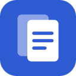
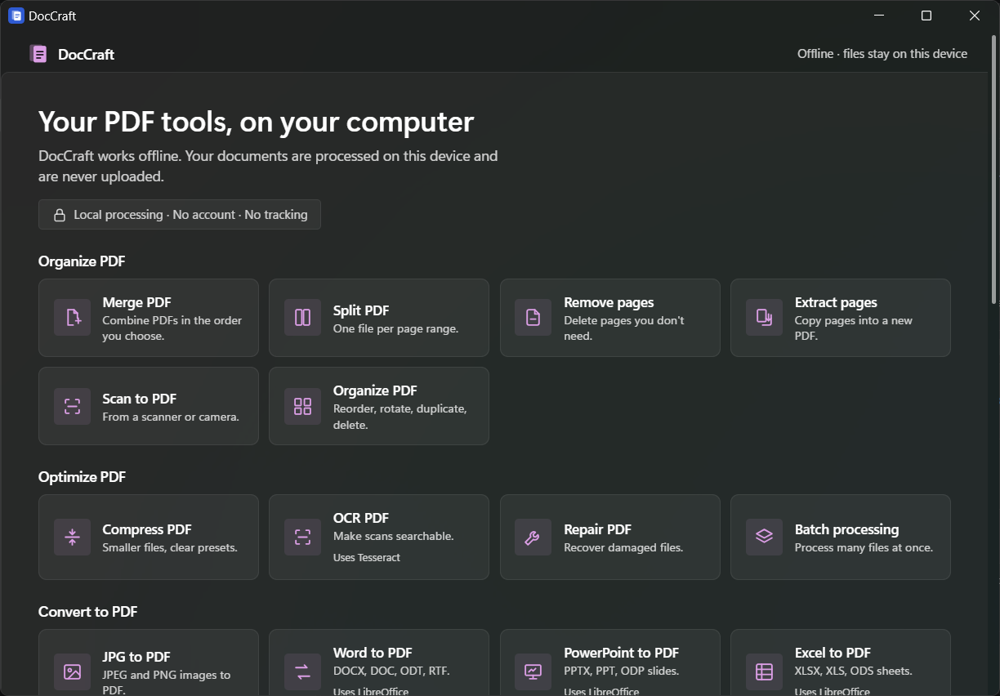
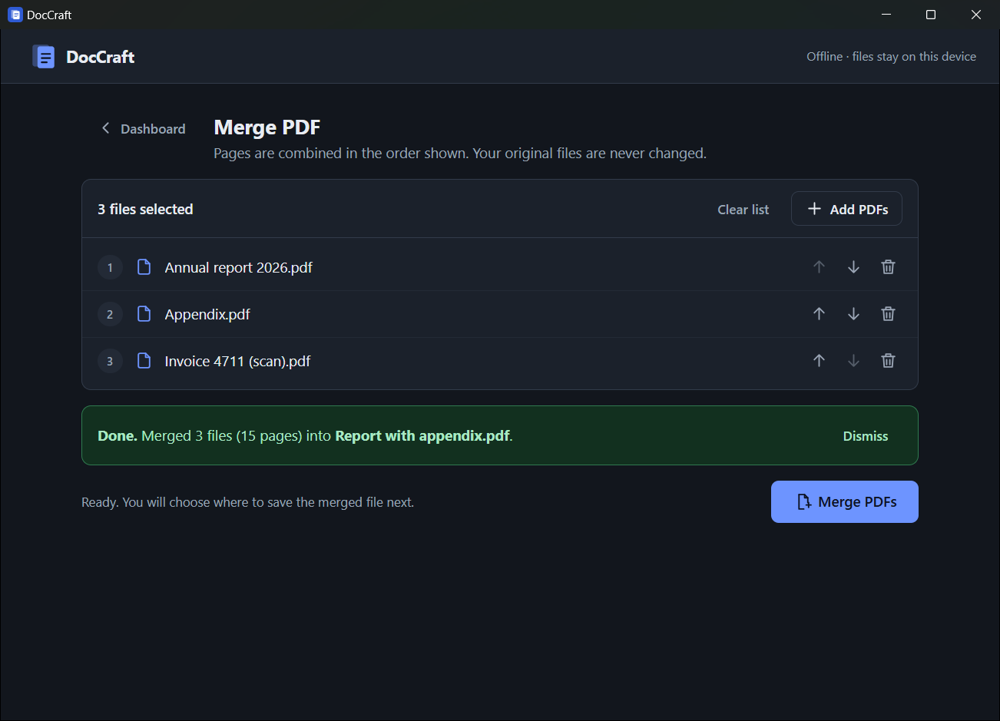
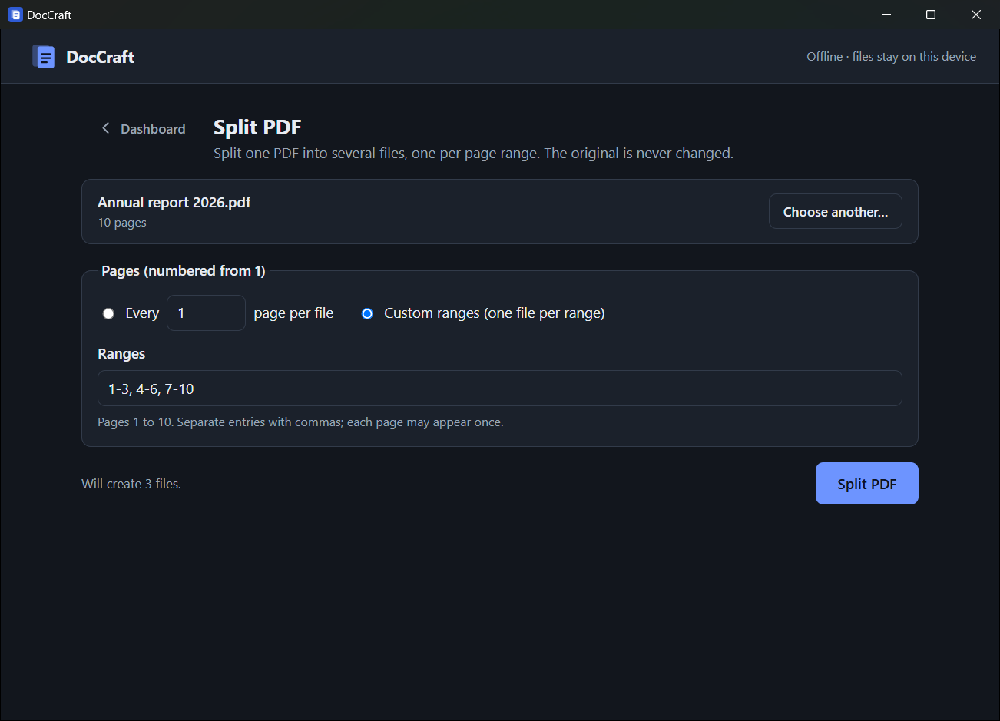
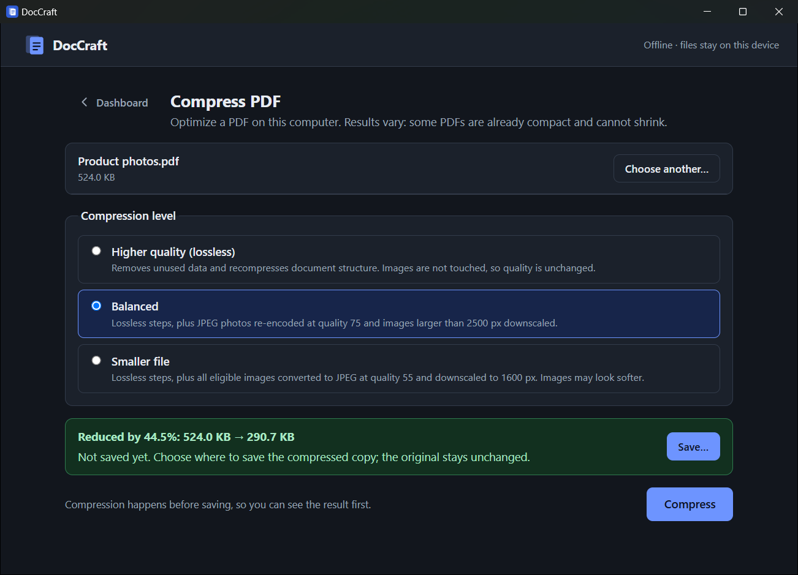
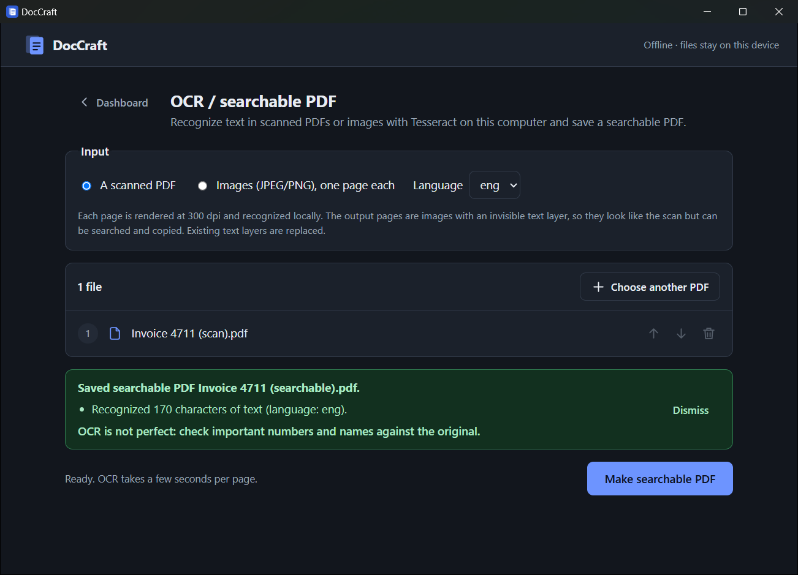
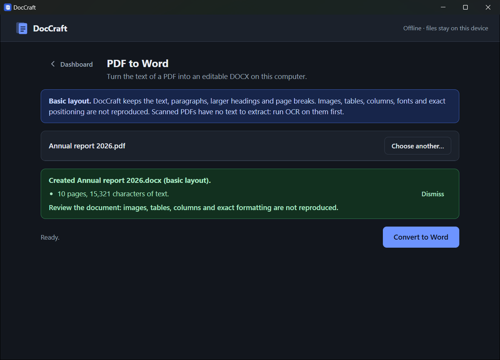
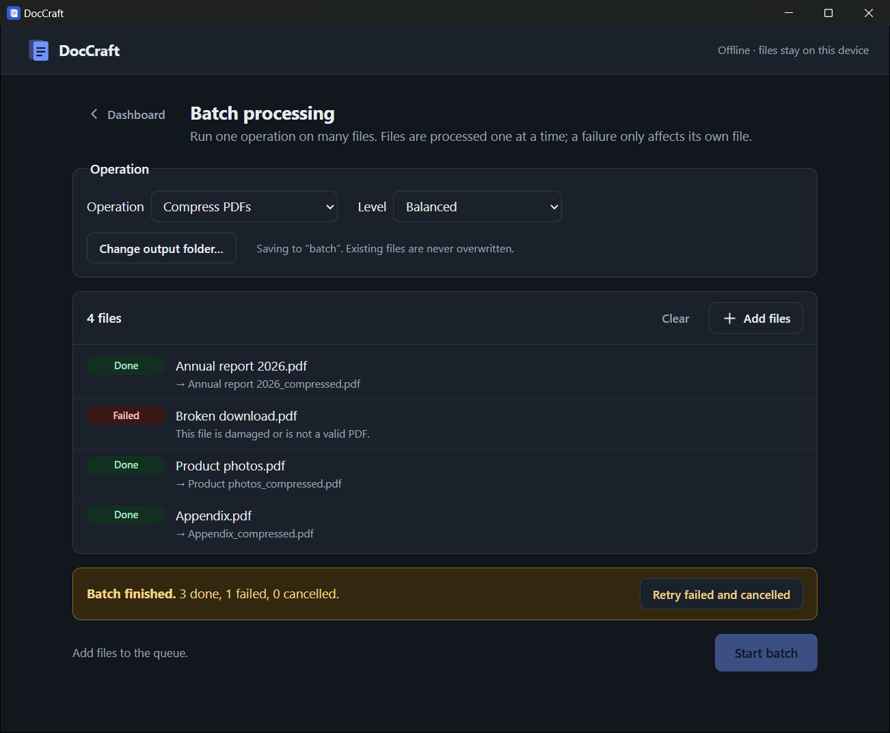

<div align="center">



# DocCraft

**Everyday PDF tools that run entirely on your computer.**
Merge, split, compress, convert and OCR your documents: no uploads, no account, no tracking.


<a href="https://github.com/pushkar-jat/DocCraft/releases/latest/download/DocCraft_x64-setup.exe"></a>

<sub>Windows 10/11, 64-bit · about 4 MB · <a href="https://github.com/pushkar-jat/DocCraft/releases">all releases</a></sub>



</div>

## Why DocCraft?

Online PDF sites are convenient, but they ask you to upload contracts, invoices, IDs and reports to someone else's server. **DocCraft gives you the same everyday tools as a small desktop app that keeps every file on your device.** It works without an internet connection, needs no sign-up, and contains no analytics.

## Features

| | Tool | What it does |
|---|---|---|
| 📎 | **Merge PDF** | Combine PDFs in the order you choose |
| ✂️ | **Split PDF** | One file per page range, or every N pages |
| 📄 | **Extract pages** | Copy pages, in any order (`3, 1, 5-8`), into a new PDF |
| 🗜️ | **Compress PDF** | Three clear presets, with before/after size shown |
| 🖼️ | **Images to PDF** | JPEG/PNG to one PDF; phone-photo rotation respected |
| 📝 | **PDF to Word** | Editable DOCX from a text PDF *(basic layout)* |
| 📃 | **Word to PDF** | DOCX, DOC, ODT, RTF to PDF *(uses LibreOffice)* |
| 🔍 | **OCR / searchable PDF** | Make scans searchable and copyable *(uses Tesseract)* |
| 📚 | **Batch processing** | Compress or convert many files at once |

Built to be trustworthy:
- **Originals are never changed.** Outputs can never replace an input, and Windows asks before replacing any other file.
- **Honest results.** If a PDF can't be made smaller, DocCraft says so instead of saving a bigger file. Limits like "basic layout" are shown next to the button.
- **Cancel anything.** Cancelling stops the work immediately and leaves nothing behind.
- **Accessible.** Keyboard-operable, screen-reader-friendly status messages, light and dark themes.

## Screenshots

<table>
  <tr>
    <td width="50%"><br><sub><b>Merge</b>: arrange files, then merge in that order</sub></td>
    <td width="50%"><br><sub><b>Split</b>: page ranges validated as you type</sub></td>
  </tr>
  <tr>
    <td><br><sub><b>Compress</b>: see the saving before you save</sub></td>
    <td><br><sub><b>OCR</b>: scanned invoice turned into searchable text</sub></td>
  </tr>
  <tr>
    <td><br><sub><b>PDF to Word</b>: editable text, honest about layout</sub></td>
    <td><br><sub><b>Batch</b>: one bad file never stops the rest</sub></td>
  </tr>
</table>

## Privacy

- All processing happens on your device: in the app itself, or in LibreOffice/Tesseract running locally.
- DocCraft contains **no network code**, and its security policy blocks connections to anything except the app itself.
- The app can only open files you pick in a Windows file dialog, and only save where you choose.
- No accounts, telemetry, analytics, ads or cloud features.

Details: [docs/ARCHITECTURE.md → Security boundaries](docs/ARCHITECTURE.md#security-boundaries).

---

## Installation

### Download (Windows 10/11, 64-bit)

1. **[⬇ Download DocCraft_x64-setup.exe](https://github.com/pushkar-jat/DocCraft/releases/latest/download/DocCraft_x64-setup.exe)** (always the latest version). Older versions are on the [Releases](https://github.com/pushkar-jat/DocCraft/releases) page.
2. Run it. Because DocCraft is not code-signed yet, Windows SmartScreen may show *"Windows protected your PC"*: click **More info → Run anyway**.
3. Start **DocCraft** from the Start menu.

An `.msi` package is also provided for managed/IT installs.

### Optional: Word to PDF and OCR

These two tools use free programs that you install once. DocCraft finds them automatically and shows setup help if they are missing.

```powershell
winget install TheDocumentFoundation.LibreOffice   # Word to PDF
winget install UB-Mannheim.TesseractOCR            # OCR (English included)
```

Everything else works without any extra software.

### Uninstall

Settings → Apps → Installed apps → **DocCraft** → Uninstall.

## Known limitations

- **PDF to Word** keeps text, paragraphs, headings and page breaks. Images, tables and columns are not reproduced yet.
- **Compression** helps most with photo-heavy PDFs; already-optimized or scanned (JBIG2/CCITT) PDFs may not shrink.
- **Password-protected PDFs** are not supported yet.
- Windows only for now; macOS and Linux builds are planned.

Full list: [docs/PHASE_2_STATUS.md](docs/PHASE_2_STATUS.md#known-limitations).

## Building from source

**Requirements:** Node.js LTS, Rust stable (MSVC), [Microsoft C++ Build Tools](https://visualstudio.microsoft.com/visual-cpp-build-tools/) ("Desktop development with C++"), WebView2. Step-by-step guide: [docs/SETUP_WINDOWS.md](docs/SETUP_WINDOWS.md).

```powershell
git clone https://github.com/pushkar-jat/DocCraft.git
cd DocCraft
npm install
npm run tauri dev      # run the app in development mode
npm run tauri build    # build installers → src-tauri/target/release/bundle/{nsis,msi}/
```

**Tests and checks**

```powershell
npm test                          # frontend tests (Vitest)
npm run typecheck                 # TypeScript (app + tests)
cd src-tauri; cargo test          # Rust tests (LibreOffice/Tesseract tests skip if not installed)
cargo clippy --all-targets        # lint
```

## Tech stack

[Tauri 2](https://tauri.app) (Rust) · React 19 + TypeScript · [pdf-lib](https://pdf-lib.js.org) · [pdf.js](https://mozilla.github.io/pdf.js/) · [lopdf](https://github.com/J-F-Liu/lopdf) · [image](https://github.com/image-rs/image) · [fflate](https://github.com/101arrowz/fflate) · optional [LibreOffice](https://www.libreoffice.org) and [Tesseract](https://github.com/tesseract-ocr/tesseract) · Vitest

## Documentation

| Document | Contents |
|---|---|
| [Architecture](docs/ARCHITECTURE.md) | Components, data flow, file-access model, security boundaries, source map |
| [Design](docs/DESIGN.md) | UX principles, screen anatomy, job lifecycle, visual tokens, accessibility, adding a tool |
| [Setup (Windows)](docs/SETUP_WINDOWS.md) | Toolchain, engines, troubleshooting |
| [Third-party notices](docs/THIRD_PARTY_NOTICES.md) | Licences of every bundled component and the detected engines |
| [Status](docs/PHASE_2_STATUS.md) · [Test plan](docs/PHASE_2_TEST_PLAN.md) · [Acceptance](docs/PHASE_2_ACCEPTANCE.md) | What is verified, how, and what is still open |
| [Product spec](docs/PRODUCT_SPEC.md) | Principles and roadmap |

## Contributing

Contributions are welcome! Please read [CONTRIBUTING.md](CONTRIBUTING.md) first. DocCraft has a few strict rules (local-only, least privilege, honest features). Changes are tracked in [CHANGELOG.md](CHANGELOG.md).

## License

DocCraft is released under the [MIT License](LICENSE). Third-party components keep their own licences: see [docs/THIRD_PARTY_NOTICES.md](docs/THIRD_PARTY_NOTICES.md).

---

<sub>DocCraft is an independent open-source project and is not affiliated with Adobe, Microsoft, The Document Foundation, the Tesseract project or ArtCraft. The name is provisional.</sub>
