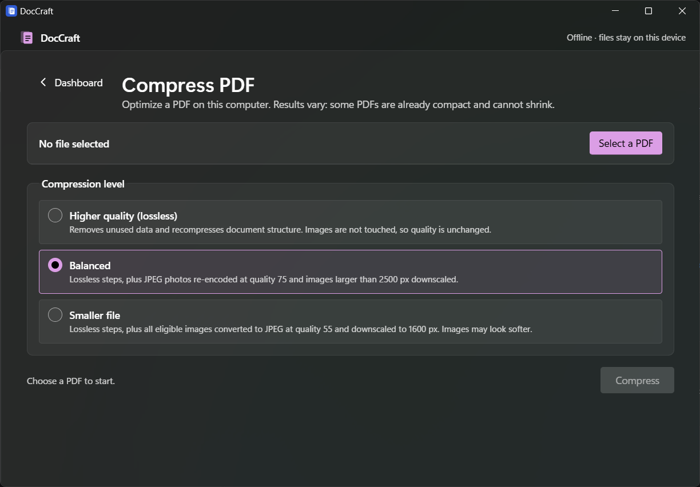
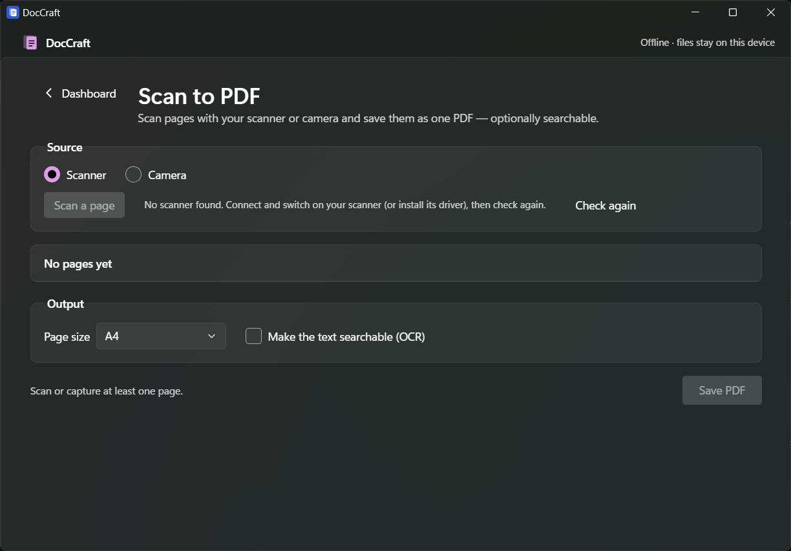

<div align="center">


# DocCraft

**Everyday PDF tools that run entirely on your computer.**
Merge, split, compress, convert, edit, sign, protect and OCR your documents: no uploads, no account, no tracking.


<a href="https://github.com/pushkar-jat/DocCraft/releases/download/doccraft_v1.0.0/DocCraft_0.2.0_x64-setup.exe"></a>

<sub>Windows 10/11, 64-bit · about 5 MB · <a href="https://github.com/pushkar-jat/DocCraft/releases">all releases</a></sub>


</div>

## Why DocCraft?

Online PDF sites are convenient, but they ask you to upload contracts, invoices, IDs and reports to someone else's server. **DocCraft gives you the same everyday tools as a small desktop app that keeps every file on your device.** It works without an internet connection, needs no sign-up, and contains no analytics.

## What's new in 0.2.0

- **32 tools instead of 9**: page organizing, scanning, repair, Office and HTML conversions, PDF to Excel/PowerPoint/PDF-A/Markdown, editing, forms, watermarks, page numbers, protect/unlock, signing (including certificate signatures), redaction and compare.
- **Windows 11 look**: Mica window background, your own Windows accent colour, Segoe UI Variable and Fluent controls. Light and dark follow your Windows setting.

Full list: [CHANGELOG.md](CHANGELOG.md).

## Features

32 working tools in seven groups. Tools marked *LO* use LibreOffice and *OCR* uses Tesseract (both free, installed separately, detected automatically).

| Group | Tools |
|---|---|
| **Organize** | Merge PDF · Split PDF · Remove pages · Extract pages · Organize PDF (reorder, rotate, duplicate, delete and insert blank pages on thumbnails) · Scan to PDF (scanner or camera) |
| **Optimize** | Compress PDF (three presets, before/after size) · Repair PDF · OCR PDF *(OCR)* · Batch processing |
| **Convert to PDF** | JPG/PNG to PDF · Word to PDF *(LO)* · PowerPoint to PDF *(LO)* · Excel to PDF *(LO)* · HTML to PDF *(LO, remote content blocked)* |
| **Convert from PDF** | PDF to JPG/PNG · PDF to Word · PDF to Excel · PDF to PowerPoint *(LO)* · PDF to PDF/A *(LO)* |
| **Edit** | Rotate PDF · Add page numbers · Add watermark (text or image) · Crop PDF · Edit PDF (add text, images, shapes, highlights, white-out) · PDF Forms (fill in fields) |
| **Security** | Unlock PDF · Protect PDF (AES-256, print/copy/edit permissions) · Sign PDF (drawn/typed/image signature, plus optional digital signature with your .pfx certificate) · Redact PDF (true removal: redacted pages are flattened) · Compare PDF (text differences side by side) |
| **Intelligence** | PDF to Markdown |

**AI Summarizer** and **Translate PDF** are shown as *Not available yet*: they would need a cloud AI service, and DocCraft never sends your documents anywhere.

Built to be trustworthy:
- **Originals are never changed.** Outputs can never replace an input, and Windows asks before replacing any other file.
- **Honest results.** If a PDF can't be made smaller, DocCraft says so instead of saving a bigger file. Limits like "basic layout" are shown next to the button.
- **Cancel anything.** Cancelling stops the work immediately and leaves nothing behind.
- **Feels like Windows.** Windows 11 styling with Mica and your accent colour; light and dark follow the system.
- **Accessible.** Keyboard-operable, screen-reader-friendly status messages, visible focus.

## Screenshots

<table>
  <tr>
    <td width="50%"><br><sub><b>Windows 11 style</b>: Fluent controls in your accent colour</sub></td>
    <td width="50%"><br><sub><b>Scan to PDF</b>: scanner or camera, optional OCR</sub></td>
  </tr>
  <tr>
    <td width="50%"><br><sub><b>Merge</b>: arrange files, then merge in that order</sub></td>
    <td width="50%"><br><sub><b>Split</b>: page ranges validated as you type</sub></td>
  </tr>
  <tr>
    <td><br><sub><b>Compress</b>: see the saving before you save</sub></td>
    <td><br><sub><b>OCR</b>: scanned invoice turned into searchable text</sub></td>
  </tr>
  <tr>
    <td><br><sub><b>PDF to Word</b>: editable text, honest about layout</sub></td>
    <td><br><sub><b>Batch</b>: one bad file never stops the rest</sub></td>
  </tr>
</table>

<sub>The lower four screenshots show results from an earlier version; tool behaviour is unchanged, only the styling is new.</sub>

## Privacy

- All processing happens on your device: in the app itself, or in LibreOffice/Tesseract running locally.
- DocCraft contains **no network code**, and its security policy blocks connections to anything except the app itself.
- The app can only open files you pick in a Windows file dialog, and only save where you choose.
- No accounts, telemetry, analytics, ads or cloud features.

Details: [docs/ARCHITECTURE.md → Security boundaries](docs/ARCHITECTURE.md#security-boundaries).

---

## Installation

### Download (Windows 10/11, 64-bit)

1. **[⬇ Download DocCraft_0.2.0_x64-setup.exe](https://github.com/pushkar-jat/DocCraft/releases/download/doccraft_v1.0.0/DocCraft_0.2.0_x64-setup.exe)** (version 0.2.0, about 5 MB). Older versions are on the [Releases](https://github.com/pushkar-jat/DocCraft/releases) page.
2. Run it. Because DocCraft is not code-signed yet, Windows SmartScreen may show *"Windows protected your PC"*: click **More info → Run anyway**.
3. Start **DocCraft** from the Start menu.

**Updating:** run the new installer. It replaces the old version in place; DocCraft stores no documents, so nothing is lost.

The Mica background needs Windows 11; on Windows 10 the app uses a solid background and works the same.

### Optional: Office conversions and OCR

The Office/HTML/PowerPoint/PDF-A conversions and OCR use free programs that you install once. DocCraft finds them automatically and shows setup help if they are missing.

```powershell
winget install TheDocumentFoundation.LibreOffice   # Office/HTML to PDF, PDF to PowerPoint, PDF/A
winget install UB-Mannheim.TesseractOCR            # OCR, searchable scans (English included)
```

Everything else works without any extra software.

### Uninstall

Settings → Apps → Installed apps → **DocCraft** → Uninstall.

## Known limitations

- **PDF to Word / Excel / Markdown** rebuild text and simple tables from the PDF's text layer. Images and complex layouts are not reproduced; scanned PDFs need OCR first.
- **Edit PDF** adds new content on top of pages; it does not re-flow or change existing text.
- **Digital signatures** are PAdES baseline (B-B) without a trusted timestamp; self-signed certificates show as "unknown signer" in other readers.
- **Compare** compares text, not visual appearance.
- **Scan to PDF** uses the Windows scanner dialog (WIA); camera capture has no automatic edge detection.
- **Compression** helps most with photo-heavy PDFs; already-optimized or scanned (JBIG2/CCITT) PDFs may not shrink.
- **Password-protected PDFs**: open them with Unlock PDF first (you need the password).
- Windows only for now; macOS and Linux builds are planned.

Full lists: [toolkit status](docs/TOOLKIT_STATUS.md#still-open) and [Phase 2 limitations](docs/PHASE_2_STATUS.md#known-limitations).

## Building from source

**Requirements:** Node.js LTS, Rust stable (MSVC), [Microsoft C++ Build Tools](https://visualstudio.microsoft.com/visual-cpp-build-tools/) ("Desktop development with C++"), WebView2. Step-by-step guide: [docs/SETUP_WINDOWS.md](docs/SETUP_WINDOWS.md).

```powershell
git clone https://github.com/pushkar-jat/DocCraft.git
cd DocCraft
npm install
npm run tauri dev      # run the app in development mode
npm run tauri build    # build installers → src-tauri/target/release/bundle/{nsis,msi}/
```

**Tests and checks**

```powershell
npm test                          # frontend tests (Vitest)
npm run typecheck                 # TypeScript (app + tests)
cd src-tauri; cargo test          # Rust tests (LibreOffice/Tesseract tests skip if not installed)
cargo clippy --all-targets        # lint
```

## Tech stack

[Tauri 2](https://tauri.app) (Rust) · React 19 + TypeScript · [pdf-lib](https://pdf-lib.js.org) · [pdf.js](https://mozilla.github.io/pdf.js/) · [lopdf](https://github.com/J-F-Liu/lopdf) · RustCrypto ([cms](https://github.com/RustCrypto/formats), rsa, p256/p384) · [image](https://github.com/image-rs/image) · [fflate](https://github.com/101arrowz/fflate) · optional [LibreOffice](https://www.libreoffice.org) and [Tesseract](https://github.com/tesseract-ocr/tesseract) · Vitest

## Documentation

| Document | Contents |
|---|---|
| [Architecture](docs/ARCHITECTURE.md) | Components, data flow, file-access model, security boundaries, source map |
| [Design](docs/DESIGN.md) | UX principles, screen anatomy, job lifecycle, visual tokens, accessibility, adding a tool |
| [Setup (Windows)](docs/SETUP_WINDOWS.md) | Toolchain, engines, troubleshooting |
| [Third-party notices](docs/THIRD_PARTY_NOTICES.md) | Licences of every bundled component and the detected engines |
| [Toolkit status](docs/TOOLKIT_STATUS.md) · [Phase 2 status](docs/PHASE_2_STATUS.md) · [Test plan](docs/PHASE_2_TEST_PLAN.md) · [Acceptance](docs/PHASE_2_ACCEPTANCE.md) | What is verified, how, and what is still open |
| [Product spec](docs/PRODUCT_SPEC.md) | Principles and roadmap |

## Contributing

Contributions are welcome! Please read [CONTRIBUTING.md](CONTRIBUTING.md) first. DocCraft has a few strict rules (local-only, least privilege, honest features). Changes are tracked in [CHANGELOG.md](CHANGELOG.md).

## License

DocCraft is released under the [MIT License](LICENSE). Third-party components keep their own licences: see [docs/THIRD_PARTY_NOTICES.md](docs/THIRD_PARTY_NOTICES.md).

---

<sub>DocCraft is an independent open-source project and is not affiliated with Adobe, Microsoft, The Document Foundation, the Tesseract project or ArtCraft. The name is provisional.</sub>
