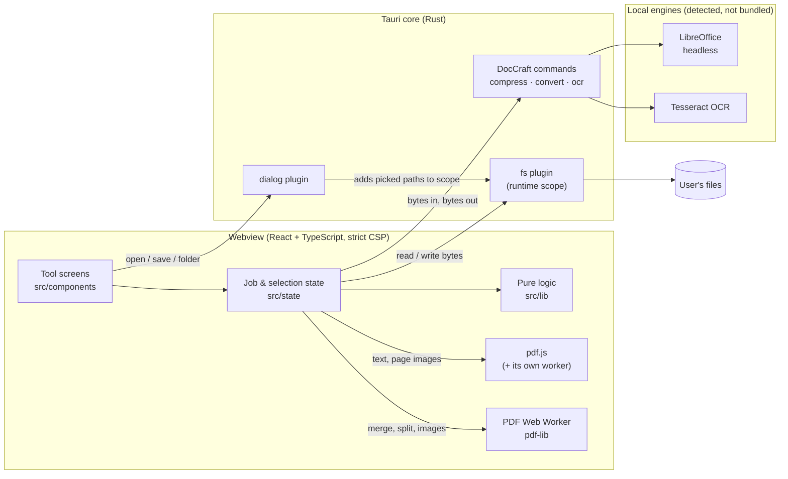
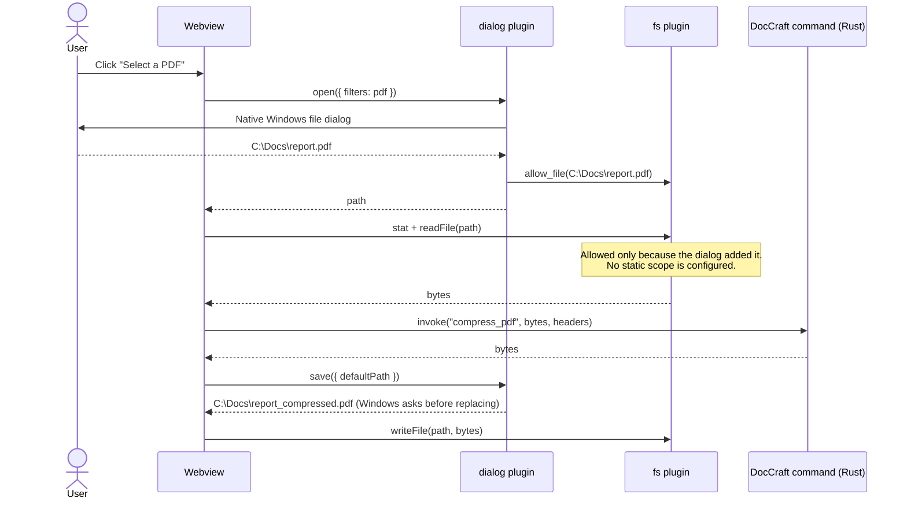
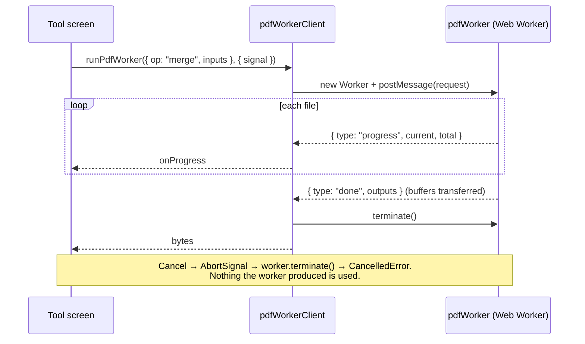
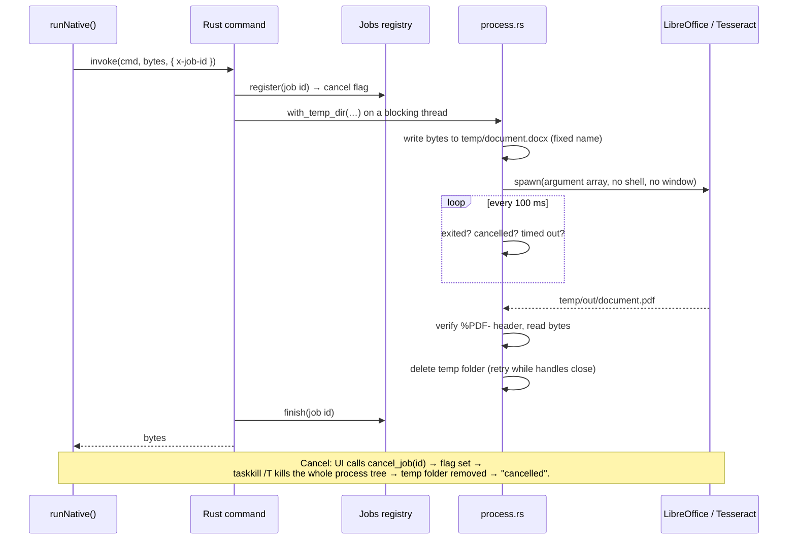
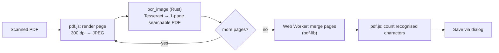
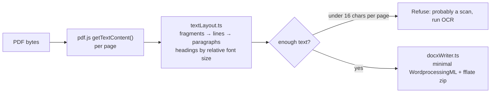
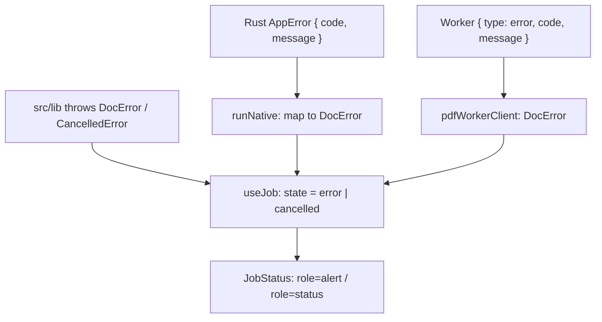

# DocCraft Architecture

This document explains how DocCraft is built: its runtime pieces, how a document moves through the app, the security boundaries, and where to find things in the code. For UI and interaction design, see [DESIGN.md](DESIGN.md).

## Goals that shape the architecture

| Goal | Consequence |
|---|---|
| **Documents never leave the computer** | No network code; strict CSP; pdf.js data files bundled; engines run as local processes |
| **Least privilege** | The UI can only touch files the user picked in a native dialog. Rust commands never receive file paths. Every command needs an explicit capability. |
| **Responsive UI** | Heavy work runs in a Web Worker, in pdf.js's worker, in Rust threads, or in external processes; never on the UI thread |
| **Honest results** | Every operation either produces a verified output or fails with a specific, user-readable reason. No partial outputs. |
| **Portable** | Business logic is plain TypeScript and Rust; Windows-specific code is limited to engine discovery and process-tree killing |

## Runtime overview



**Where each tool runs**

| Tool | Engine | Thread / process |
|---|---|---|
| Merge, Split, Extract, Images to PDF | pdf-lib | Dedicated Web Worker (terminated on cancel) |
| PDF to Word | pdf.js text extraction + DocCraft's DOCX writer | pdf.js worker + main thread (light) |
| Compress | lopdf + image (Rust) | Tokio blocking thread |
| Word to PDF | LibreOffice | Child process, private profile |
| OCR | pdf.js page rendering + Tesseract + pdf-lib assembly | Main thread canvas, child process, Web Worker |
| Batch | Any of the above, one file at a time | Same as the single-file tool |

## File access model

The single most important design rule: **the frontend can only read and write what the user picked, and Rust never sees a user path.**



- `src-tauri/capabilities/default.json` grants only `dialog:allow-open`, `dialog:allow-save`, and `fs:allow-read-file` / `write-file` / `stat` / `exists`. **No `fs:scope-*` entries**: without a dialog selection, every fs call is denied.
- Folder pickers (split, batch) add the folder's direct children to the scope, so outputs can be created there. Names are always checked with `exists` first, and a free `name (2).pdf` is chosen instead of overwriting.
- DocCraft's own commands are declared in an app manifest (`src-tauri/build.rs`), which makes each one require an explicit `allow-…` permission.

## Processing pipelines

### pdf-lib operations (Web Worker)



The worker protocol is typed in `src/workers/pdfWorkerProtocol.ts`. The pure functions it calls (`mergePdfs`, `splitPdf`, `extractPages`, `imagesToPdf`) live in `src/lib` and are tested directly, without a worker.

### Native commands (raw binary IPC)

Commands take the document as a raw request body (`invoke(cmd, Uint8Array, { headers })`) and return raw bytes (`tauri::ipc::Response`). There is no JSON encoding of file contents. Options travel as headers (`x-preset`, `x-extension`, `x-languages`, `x-dpi`, `x-job-id`).



Progress for compression (per image) is sent with `app.emit("job-progress", { jobId, current, total })`. Engines that cannot report progress (LibreOffice, a single Tesseract page) show an indeterminate bar; percentages are never invented.

### OCR pipeline



The orchestration (`src/lib/ocrPipeline.ts`) takes its render, recognize and combine steps as injected dependencies, so it is unit-tested without pdf.js or Tesseract. A Rust test runs the real Tesseract on a rendered image.

### PDF to Word



### Compression (Rust)

`src-tauri/src/compress.rs`. Presets map to concrete behaviour:

| Preset | Lossless pass | Images |
|---|---|---|
| `high` | prune unused objects, re-deflate Flate streams at level 9, compress raw streams, object + xref streams | untouched |
| `balanced` | same | JPEGs re-encoded at q75; any eligible image > 2500 px downscaled (lossless images stay lossless) |
| `small` | same | all eligible images → JPEG q55, ≤ 1600 px |

An image is replaced only if the result is at least 5% smaller. Eligible means 8-bit RGB or greyscale (ICC-based allowed), DCT or Flate, and no Decode array or stencil mask. Decompression is capped at 256 MB per stream (bomb protection). The output is reloaded and its page count compared before it is returned.

## Error model



- `DocError` has a typed `code` (`not-pdf`, `encrypted`, `too-large`, `engine-missing`, `no-text`, …) and a message written for the user that names the **file name only, never the full path**.
- `CancelledError` always means "nothing was written".
- Unknown errors become a generic message; no stack traces or document contents reach the UI or logs.

## Security boundaries

| Boundary | Control |
|---|---|
| Webview → network | CSP: `default-src 'self'`, `connect-src 'self' ipc:`, `script-src 'self' 'wasm-unsafe-eval'` (WebAssembly image decoders only; JS `eval` blocked), `object-src 'none'`, `frame-src 'none'` |
| Webview → filesystem | fs plugin with runtime scope only (dialog selections) |
| Webview → Rust | Only 5 declared commands, each explicitly allowed; inputs are bytes plus validated header values |
| Rust → OS processes | Absolute engine paths from known locations; argument arrays; fixed file names in a private temp folder; timeout; process-tree kill |
| Untrusted documents | Signature checks (not extensions), bounded decompression, size caps, encrypted files refused, outputs re-validated |
| LibreOffice | Private profile: macros disabled, untrusted referer links blocked, update checks and usage reporting off; one conversion at a time |

## Source map

```
src/
  App.tsx                    view routing (dashboard ↔ tools), EnginesProvider
  components/                Dashboard, MergeView, FileList, JobStatus, ToolLayout, EngineNotice, Icons
  components/tools/          Split/Extract, Compress, Images, PDF→Word, Word→PDF, OCR, Batch screens
  lib/                       pure, tested logic
    pageRanges.ts            "1-3, 5" parser and validation
    merge.ts split.ts images.ts   pdf-lib operations
    textLayout.ts docxWriter.ts pdfToDocx.ts   PDF → DOCX
    ocrPipeline.ts batch.ts  orchestration with injected dependencies
    selection.ts naming.ts paths.ts errors.ts workflow.ts progress.ts
  services/                  side effects
    tauriFiles.ts            dialogs + scoped fs (the only file I/O in the app)
    native.ts                Rust command calls, progress events, cancellation
    pdfWorkerClient.ts       Web Worker lifecycle
    pdfjs.ts                 lazy pdf.js + local asset URLs + page rendering
    operations.ts output.ts  high-level operations shared by tools and batch
  state/                     useJob (generic progress/cancel/result), merge reducer, engine detection
  workers/                   pdf-lib worker + typed protocol
src-tauri/src/
  lib.rs                     commands, raw IPC, job registry wiring
  compress.rs convert.rs ocr.rs   operations
  engines.rs                 LibreOffice / Tesseract discovery
  process.rs                 safe process runner, temp-folder lifecycle
  jobs.rs errors.rs
scripts/copy-pdfjs-assets.mjs     bundles pdf.js data files (excludes GPL fonts)
```

## Testing strategy

| Layer | Tool | What is covered |
|---|---|---|
| Pure TS logic | Vitest (Node) | Ranges, naming/collisions, selection, layout, DOCX structure, batch runner, OCR orchestration, EXIF orientation maths |
| PDF operations | Vitest + real pdf-lib / pdf.js | Page order and counts, invalid/encrypted/empty inputs, cancellation; PDFs generated in tests |
| Cross-engine | Vitest + LibreOffice (skips if absent) | Generated DOCX opens in a real word processor |
| Rust | `cargo test` | Compression presets on generated PDFs, encrypted/invalid inputs, cancellation, temp cleanup, real LibreOffice and Tesseract runs (skip if absent) |
| Desktop app | Manual plan + scripted runs | `docs/PHASE_2_TEST_PLAN.md`; native dialogs, real files, release build under CSP |

## Platform notes

- **Windows** (primary): engines found under `%ProgramFiles%` / `%LOCALAPPDATA%` / PATH; process trees killed with `taskkill /T`; WebView2 renders the UI.
- **macOS / Linux**: the code compiles for them (paths for `/Applications/LibreOffice.app`, Homebrew and `/usr/bin` are included), but they are untested. Child processes are killed directly (no tree kill yet). The bundle identifier must change before a macOS build (`com.doccraft.app` clashes with the `.app` extension).
