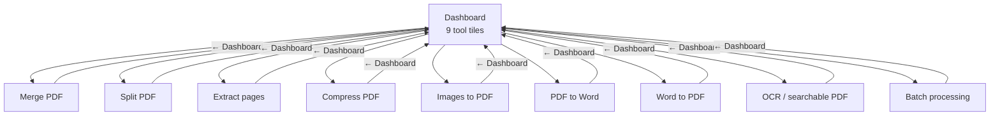
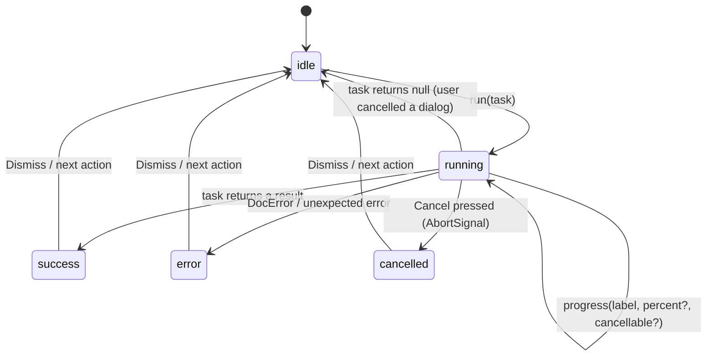

# DocCraft Design

How DocCraft looks and behaves, and the rules new screens should follow. For the technical structure, see [ARCHITECTURE.md](ARCHITECTURE.md).

## Design principles

1. **Trust first.** People use DocCraft *because* their files are private. The app says so in plain words ("Your documents are processed on this device and are never uploaded") and never does anything that contradicts it.
2. **Honest capability.** A button either works or is not there. Tools that need LibreOffice or Tesseract say so before you start. Results state exactly what happened, including "could not be made smaller" and "basic layout".
3. **One pattern, many tools.** Every tool screen has the same anatomy, so learning one teaches all of them.
4. **The original is sacred.** Copy and behaviour both promise that originals are never changed or silently replaced.
5. **Calm, not clever.** System fonts, one accent colour, no animation beyond progress.

## Information architecture



A flat, two-level structure: there are no menus or settings screens. The merge selection survives a trip back to the dashboard; other tools start fresh.

Tiles for engine-dependent tools carry a small tag: "Uses LibreOffice on this computer", or "Needs LibreOffice (not found) — open for setup" when it is missing.

## Anatomy of a tool screen

```
┌──────────────────────────────────────────────────────────────┐
│ ‹ Dashboard   Tool title                                      │  ToolLayout header
│               One sentence: what it does + reassurance         │
├──────────────────────────────────────────────────────────────┤
│ [Engine notice — only if LibreOffice/Tesseract is missing]    │  EngineNotice
├──────────────────────────────────────────────────────────────┤
│ Input: chosen file name · size/pages        [Choose another…] │  SingleFilePicker / FileList
├──────────────────────────────────────────────────────────────┤
│ Options (fieldset with legend): presets, ranges, language…    │  form-panel
├──────────────────────────────────────────────────────────────┤
│ Status: progress + Cancel │ result │ error                    │  JobStatus (live region)
├──────────────────────────────────────────────────────────────┤
│ Hint explaining what is missing / what happens next   [Run]   │  ActionBar
└──────────────────────────────────────────────────────────────┘
```

- **One primary button** per screen, bottom right, labelled with a verb ("Merge PDFs", "Make searchable PDF").
- When the button is disabled, the hint to its left always says why ("Add at least one more PDF", "LibreOffice is required for this tool").
- **Where outputs go:** a save dialog opens when the user presses the primary button, before any work starts. Compress is the exception: it shows the size reduction first, then offers Save. Split and Batch ask for a folder.

## Job lifecycle

All tools except Merge (which keeps its Phase 1 reducer) use one hook, `useJob` (`src/state/useJob.ts`):



Rules:
- **Double submission is impossible.** A synchronous ref guards `run` before React re-renders the disabled button.
- **Dialogs count as running** (Cancel disabled, label "Choose where to save the result in the dialog"), so the screen cannot change underneath an open dialog.
- **Cancel** is enabled only while the work can actually stop. Once writing to disk has started, it is disabled.
- **Progress bars are honest.** They are determinate only when the engine reports real steps (pages, images, files); otherwise they are indeterminate. A percentage is never estimated.
- **Success has two tones.** `success` (green) for "done"; `info` (blue) for outcomes that are not a success, such as "could not be made smaller".

## Visual design

Tokens live at the top of `src/App.css` and switch automatically with the system light/dark setting.

| Token | Light | Dark | Use |
|---|---|---|---|
| `--bg` | `#f4f6f9` | `#12161d` | Window background |
| `--surface` | `#ffffff` | `#1b212b` | Panels, tiles |
| `--accent` | `#2f5bd3` | `#6d94ff` | Primary buttons, icons, focus of attention |
| `--text` / `--text-muted` | `#17202c` / `#5a6575` | `#e8ecf2` / `#9aa5b5` | Body / secondary text |
| `--success-*`, `--error-*`, `--info-*`, `--warning-*` | tinted backgrounds + borders + text | darker tints | Status panels and batch chips |
| `--radius` | 10px | | Panels, tiles |

- **Type:** the system UI font ("Segoe UI" on Windows). Titles 1.45–1.7rem at weight 650; body 15px / 1.5. No web fonts, so nothing is fetched.
- **Icons:** inline SVG, 24px grid, 1.8px stroke (`src/components/Icons.tsx`). Decorative icons are `aria-hidden`.
- **Layout:** content column max 920px, centred. The tool grid uses `auto-fill, minmax(260px, 1fr)`. The window minimum is 720×520.
- **Motion:** only progress bars animate, and they stop under `prefers-reduced-motion`.

## Accessibility

- Native controls throughout: `<button>`, `<input type="radio">`, `<select>`, `<fieldset>` + `<legend>`, `<label>`. Everything is keyboard-operable with standard keys.
- Global visible focus ring (`:focus-visible`, 2px, accent colour).
- Icon-only buttons have explicit labels ("Move report.pdf up", "Remove report.pdf from the list").
- Status areas use `role="status"` / `aria-live="polite"`; errors use `role="alert"`; progress uses `role="progressbar"` with values when known and `aria-busy` when indeterminate.
- Inline field validation is announced (`aria-live`) and linked with `aria-describedby` / `aria-invalid`.
- Colour is never the only signal: batch chips say "Done" / "Failed", and statuses have text.

## Writing guidelines

- Say what happened and what to do next: *"“scan.pdf” has little or no selectable text — it is probably a scanned image. Run "OCR / searchable PDF" on it first, then convert the result to Word."*
- Name files by **file name only**, never the full path.
- Never blame the user; never say "error occurred".
- State limits up front, next to the action, not only in docs ("Basic layout", "Images may look softer").
- After cancel or failure, always confirm that nothing was written.

## Adding a new tool

1. Put pure logic in `src/lib/<feature>.ts` with tests next to it. Throw `DocError` with a specific code.
2. Heavy pdf-lib work: add an `op` to `src/workers/pdfWorkerProtocol.ts` and handle it in `pdfWorker.ts`. Native work: add a bytes-in/bytes-out command in Rust, declare it in `build.rs`, and allow it in `capabilities/default.json`.
3. Expose a high-level function in `src/services/operations.ts` (so Batch can reuse it).
4. Build the screen in `src/components/tools/` from `ToolLayout`, `SingleFilePicker` / `FileList`, `JobStatus` and `ActionBar`, using `useJob`. Use `chooseSavePath` (refuses to overwrite inputs) or `freeOutputPath` (folders).
5. Add a tile in `Dashboard.tsx`, and a route in `App.tsx`.
6. Update the README tools table, `docs/THIRD_PARTY_NOTICES.md` (any new dependency) and the test plan.
